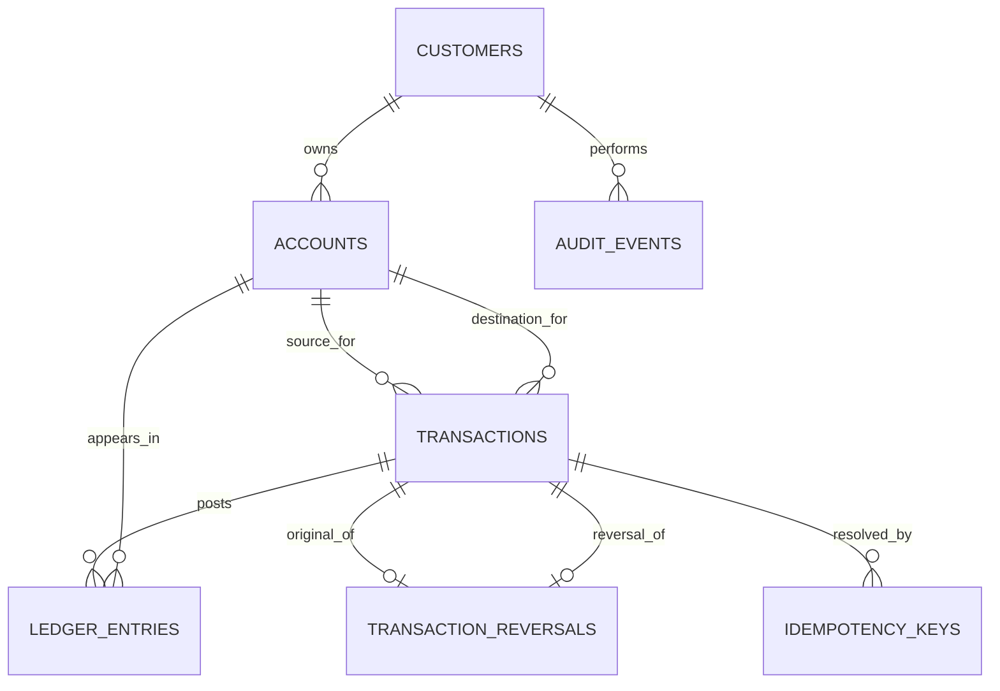

# MIT 8103 Advanced Database Systems Portfolio
## Detailed Implementation Playbook: Banking / Fintech Platform

**Case study:** LedgerSpring Digital Bank (LSDB) - a fictional Nigerian digital bank used only for this academic portfolio  
**Primary database:** PostgreSQL  
**NoSQL demonstration:** MongoDB for flexible transaction-event/audit projections  
**Working currency:** Nigerian naira (NGN), represented internally in kobo  
**Assessment:** MIT 8103 Advanced Database Systems, 2026/2027 session

> **Purpose of this document:** Use this as the implementation plan and completion checklist for the practical portfolio. It is not a substitute for doing, running, testing, screenshotting, and understanding the work. Adapt the SQL and examples to the versions and tools you actually install, and record what you genuinely tested.

---

## 1. Start by translating the assignment into concrete requirements

The assignment expects one realistic case study to be used consistently across five practical activities:

| Portfolio | Marks | What must be demonstrated | Minimum evidence to plan for |
|---|---:|---|---|
| 1. Database Design and Modelling | 7 | Case study, ER diagram, relational schema, keys, constraints, normalisation | ERD, schema/DDL, keys and constraints explanation, normalisation notes, successful schema build |
| 2. Query Processing and Optimisation | 7 | SQL queries, results, execution plans, indexing/optimisation, performance analysis | Query scripts, baseline and optimised plans, measured results, explanation of index trade-offs |
| 3. Transactions and Concurrency | 7 | Commit, rollback, isolation, concurrency issue or control | Reproducible SQL examples, multiple-session tests, outputs/screenshots, correctness discussion |
| 4. NoSQL and Advanced Data Models | 7 | A NoSQL model based on the same case study, implementation, suitability | Document model, sample documents, queries/aggregation, run instructions, SQL-vs-NoSQL rationale |
| 5. Distributed and Cloud Database Exercise | 6 | Discussion or setup addressing replication, sharding, availability, consistency, or deployment | Architecture diagram, configuration/demo where practical, trade-off analysis, evidence |
| Final documentation | 6 | 2-3 page summary, GitHub link, case study, screenshots/evidence, reflection, references/AI declaration where applicable | LMS-ready document plus accessible repository and declaration |

The overall rubric also rewards technical correctness, design quality, practical implementation, query/performance analysis, advanced concepts, documentation/GitHub organisation, and individual understanding. Therefore, **do not optimise only for the amount of code**. Every major decision should have implementation evidence, a test, and a brief explanation.

### Definition of done for the whole portfolio

The portfolio is ready only when:

- The fictional organisation and its scope are stated at the start and remain consistent across all five activities.
- A new reader can clone the private repository, follow the README, create the database, load synthetic data, and repeat the demonstrations.
- Scripts run in a documented order and do not rely on undocumented manual changes.
- Database rules reject invalid operations, not merely describe them in prose.
- Financial operations have test cases for success, expected failure, retry, concurrency, and reversal.
- Query plans and performance claims come from actual runs on a documented dataset and environment.
- NoSQL and distributed discussions distinguish implemented features from proposals or simulations.
- The commit history genuinely records work as it is completed throughout the semester.
- The LMS submission is 2-3 pages and links to the repository; it does not attempt to replace the practical evidence in GitHub.
- You can explain every table, constraint, query, execution plan, test, and limitation in your own words.

---

## 2. Case study: LedgerSpring Digital Bank (LSDB)

### 2.1 Organisation statement for the portfolio

**LedgerSpring Digital Bank (LSDB)** is a fictional Nigerian digital banking platform that allows registered customers to hold naira-denominated accounts and perform internal transfers, deposits, and withdrawals. The platform stores customer profiles, account details, financial transaction requests, posted ledger entries, reversal records, idempotency records, and audit events. Its database supports account management, transaction history, fund transfers, deposits and withdrawals, safe reversal of eligible transactions, balance reconciliation, operational reporting, and audit investigation.

The primary users are customers, customer-support officers, operations staff, compliance/audit staff, and the platform service. Customers initiate financial requests. Operations staff investigate transaction failures. Audit staff inspect immutable financial records and changes. The platform service enforces transaction rules and writes ledger postings.

This is a **simulated academic case study**, not a representation of a real bank's internal system. Use synthetic names, generated account numbers, fictional transactions, and fake data only. Do not upload real customer data, BVNs, payment credentials, API keys, or production records.

### 2.2 Scope and assumptions

Keep the initial scope narrow enough to finish but rich enough to demonstrate advanced database concepts.

**In scope for version 1**

- Customer registration/profile records and customer status.
- One or more customer accounts per customer.
- Account status: active, frozen, closed, or other explicitly documented states.
- NGN amounts stored as integer kobo.
- Internal transfer between two different LSDB customer accounts.
- Simulated deposit and withdrawal using bank-controlled clearing accounts.
- A financial transaction record and balanced debit/credit ledger entries.
- Idempotency for retried requests.
- Reversal of a successfully posted transaction through a compensating transaction.
- A transaction/audit history and a balance reconciliation query.
- SQL indexes and `EXPLAIN ANALYZE` evidence.
- Concurrency demonstrations with competing requests.
- A MongoDB document model for flexible transaction-event/audit search; PostgreSQL remains the financial system of record.
- A documented replication/sharding/cloud deployment design. A small local demonstration is enough where a full cloud deployment is impractical, but label simulations honestly.

**Explicitly out of scope unless you have time**

- Real payment-provider integration, card networks, foreign exchange, interest, lending, fraud scoring, real KYC checks, actual BVN verification, mobile application development, and production-grade regulatory approval.
- Real-money operations or any connection to live financial infrastructure.

**Assumptions to write down rather than leave implicit**

1. Version 1 supports NGN only. Each account and transaction still has a currency field so the model can be extended later.
2. Amounts are positive integer kobo values. Floating-point arithmetic is not used for money.
3. A normal customer account cannot be overdrawn in version 1. If overdrafts are added, define the limit and rule explicitly.
4. Pending requests do not change a customer's posted balance. Only successfully posted ledger transactions do so. If funds reservation is later added, model holds separately rather than quietly treating pending transfers as completed.
5. A full reversal is allowed at most once for a successfully posted transaction in version 1. Partial reversals are not included unless modelled separately and tested.
6. Deposits and withdrawals are simulated. They post against clearly named system clearing accounts instead of pretending external cash settlement has occurred.
7. All application timestamps use timezone-aware timestamps and are stored consistently, preferably in UTC.
8. Data used in tests and screenshots is generated and non-sensitive.

### 2.3 Important banking distinction: transaction record versus ledger

Do not treat one `transactions` table row and one mutable balance column as the entire accounting system.

- **Transaction/request record:** explains what was requested, by whom, when, the amount, the source and destination, its status, and any failure/reversal reference.
- **Ledger entries:** record the financial effect of a posted transaction. For each posted transaction, debits and credits must balance.
- **Cached account balance:** supports fast balance reads. It is a derived projection that must be updated in the same database transaction as the ledger entries and periodically reconciled against the ledger.
- **Audit event:** records who/what performed an action, what entity it concerned, when it happened, and correlation metadata. It should not be used as a substitute for the financial ledger.

For a successful internal transfer of 25,000 kobo (NGN 250.00):

| Record | Account | Side | Amount (kobo) |
|---|---|---|---:|
| Ledger entry 1 | Sender | Debit | 25,000 |
| Ledger entry 2 | Recipient | Credit | 25,000 |
| **Total** | | **Debits = credits** | **25,000 = 25,000** |

For a deposit, debit a bank cash/clearing control account and credit the customer's account. For a withdrawal, debit the customer's account and credit the clearing account. This makes deposits and withdrawals auditable and preserves the balanced-journal principle. Document the normal-side convention used by your design.

---

## 3. Recommended stack and why

Keep the environment reproducible rather than introducing tools merely to make the project look larger.

| Concern | Recommended tool | Reason / guidance |
|---|---|---|
| Primary relational database | PostgreSQL | Strong transactions, constraints, indexes, query plans, row locking, JSONB, and mature SQL support |
| SQL client | `psql` and/or pgAdmin/DBeaver | Run scripts, inspect rows, capture query results and plans |
| Schema versioning | Ordered SQL migration files | Makes schema changes reviewable and reproducible |
| ER diagram | Mermaid ER diagram, draw.io, dbdiagram.io, or pgModeler | Choose one and commit the source/export used for the portfolio |
| NoSQL | MongoDB Community/Atlas-free-tier equivalent where available | Demonstrates document modelling and flexible event metadata; not the source of truth for money |
| Local services | Docker Compose (optional but useful) | Makes local setup repeatable; do not commit secrets |
| Version control | Git + private GitHub repository | Required progressive evidence and documentation |
| Testing | SQL test scripts plus `pgTAP` if available; otherwise clear assertion queries | The test mechanism matters less than repeatability and recorded results |
| Evidence | Markdown explanations, text outputs, screenshots, `.sqlplan`/plan text, diagrams | Evidence should be understandable without guesswork |

Record the actual versions used in `docs/environment.md`, for example PostgreSQL version, MongoDB version, operating system, and any GUI/client version. Do not claim a feature was tested on a version you did not use.

### Security and credentials

- Commit `.env.example` with placeholder values only; ignore `.env`.
- Do not commit real credentials, tokens, private keys, database dumps containing real information, or secrets embedded in screenshots.
- Use separate database roles where practical: schema/migration owner, application role, and read-only analyst role.
- The application role should not be allowed to update or delete posted ledger entries directly. Prefer controlled posting logic and restrictive permissions.

---

## 4. Functional requirements and business rules

Turn these into a `docs/business-rules.md` file and link to them from the main README.

### 4.1 Customers and accounts

1. A customer has a stable primary key that is not their email address or telephone number.
2. Email/phone uniqueness should be handled intentionally. Decide whether an absent value is allowed and how normalisation/case-insensitivity works.
3. A customer in a blocked/inactive state cannot initiate a new money movement.
4. Only active customer accounts can send or receive funds unless a documented exception exists.
5. An account belongs to one customer, while one customer may own several accounts.
6. Account numbers are unique and should be generated safely. Do not derive account numbers from sequential public IDs if avoidable.
7. A closed or frozen account must not be treated like an active account for outgoing transfers. Specify separately whether it can receive funds.
8. Account ownership must be checked on the server/database path, not trusted from a client-supplied customer ID.

### 4.2 Monetary amounts

1. `amount_kobo` must be greater than zero for a normal deposit, withdrawal, or transfer.
2. Store money as an integer in the smallest supported unit (kobo); avoid `FLOAT`/`REAL`/JavaScript binary floating-point for accounting values.
3. Prevent values beyond the chosen integer range. Add explicit application validation and, if relevant, a database check for realistic maximums.
4. Both accounts in a transfer must use the same currency in version 1.
5. A transfer from an account to itself is invalid.
6. Round and convert at the API boundary if there is one; never silently truncate fractional kobo.
7. Never accept an amount of zero, a negative amount, text masquerading as a number, infinity, NaN, or an overflow value.

### 4.3 Posting and balance rules

1. A transfer succeeds only if the sender has sufficient available funds at the moment it is posted.
2. The debit from the sender, credit to the recipient, ledger entries, cached balance updates, and posted status must commit atomically.
3. If any part fails, all financial changes in that posting transaction must roll back.
4. A failed or pending transfer must not leave a debit without its matching credit.
5. A posted transaction is immutable as a financial fact. Corrections are represented by a reversal/compensating transaction, not by deleting or rewriting history.
6. Each posted transaction must balance: total debits equal total credits for the currency and journal transaction.
7. The balance cache and ledger must be reconciled. State which convention is used to calculate a customer account's balance from debit/credit entries.
8. Do not store a separately computed balance in transaction-history records as though it were authoritative.

### 4.4 Idempotency and retry rules

1. Every money-movement request has an idempotency key scoped to the caller/client or customer.
2. Repeating the same key with the same request payload returns the existing result; it must not post money a second time.
3. Reusing a key with a different payload is a conflict and must be rejected, not treated as a new transfer.
4. A request timeout does not prove that the transaction failed. A retry must query/replay by idempotency key.
5. Database uniqueness is the final guard; application-side “check then insert” alone is vulnerable to races.
6. If the key expires, the expiry policy must not accidentally allow a dangerous duplicate of an earlier payment. For this assessment, keeping keys indefinitely or defining a clear retention horizon is simpler.

### 4.5 Reversals

1. Only a transaction that reached the successful/posted state can be reversed.
2. A reversal references the original transaction and records a reason, actor, and timestamp.
3. A full reversal posts equal and opposite ledger entries; it does not delete the original entries.
4. A database uniqueness rule prevents two full reversals of the same original transaction.
5. Reversal must be atomic, idempotent, and safe under concurrent attempts.
6. Do not allow a reversal to overdraw the recipient/source in a way that violates the chosen policy. Decide whether the reversal fails, queues for investigation, or allows a controlled debt state if funds have already moved. For v1, reject the reversal when funds are insufficient and record the exception clearly.
7. A failed request is not a reversal. A failed request has no posted financial entries; a reversal offsets an already posted financial event.
8. If external rails are eventually introduced, a local reversal is not proof that an external provider has returned funds. Model settlement and provider reconciliation separately.

---

## 5. Relational model: recommended entities and relationships

Use a normalised relational schema as the foundation. Names can differ, but explain any deviations.

### 5.1 Suggested tables

| Table | Purpose | Key columns / rules |
|---|---|---|
| `customers` | Customer identity/profile and account status | `customer_id` PK, synthetic profile fields, `status`, `created_at`; unique normalised email/phone only according to documented nullability rules |
| `accounts` | Customer and system/clearing accounts | `account_id` PK, nullable `customer_id` FK for system accounts, `account_type`, unique account number for customer accounts, `currency`, `status`, optional cached customer balance in kobo, version, timestamps |
| `transactions` | Durable money-movement request/result | `transaction_id` PK, `reference` unique, type, status, positive `amount_kobo`, currency, source/destination account FKs, initiator, creation/posting times, failure code, optional reversal reference |
| `ledger_entries` | Debit/credit journal lines for each posted financial transaction | PK, `transaction_id` FK, `account_id` FK, `entry_side`, positive `amount_kobo`, currency, line number, created time; entries for posted transactions are immutable |
| `idempotency_keys` | Prevents duplicate effects from request retries | Scope + key unique, canonical request hash, transaction FK/result reference, created/expiry policy |
| `audit_events` | Append-only operational/security history | Actor, action, entity type/id, timestamp, correlation/request ID, JSONB metadata with sensitive fields excluded |
| `transaction_reversals` (or a carefully constrained reversal reference on `transactions`) | Links an original posting to its compensating transaction | Original transaction unique for full reversal, reversal transaction unique, reason, actor, time |
| `outbox_events` (optional but recommended for the SQL-to-Mongo extension) | Events committed with relational changes and later published | Unique event ID, aggregate ID, event type, payload, created/published time, retry/error fields |

You may combine or rename some tables, but avoid accidental duplication. If you use both a transaction reversal table and a reversal field on `transactions`, explain the reason and prevent the two representations from disagreeing.

### 5.2 Relationships to show on the ERD

- One customer can own many customer accounts.
- A transaction has a source account and destination account. For a transfer, both are customer accounts. For a deposit or withdrawal, one side is a configured system clearing account.
- One transaction can have multiple ledger entries; every successfully posted financial transaction must have the required balanced journal lines.
- One transaction may be referenced by a reversal record; version 1 permits at most one full reversal.
- An idempotency record resolves to the money-movement request/result it protects.
- Audit events refer to an actor and the entity/action they describe, but an audit event must not own or modify ledger state.
- An outbox event is linked by an event/aggregate identifier to the relational event that should be projected to another store.

### 5.3 Integrity constraints to implement

Use database constraints in addition to application logic. The exact SQL syntax depends on your final design.

- Primary keys for every entity.
- Foreign keys for all relationships where orphan records would be invalid.
- `NOT NULL` for required business fields.
- `CHECK (amount_kobo > 0)` for normal money-movement and ledger amounts.
- An allowed-value constraint or PostgreSQL enum for status, account type, transaction type, and entry side.
- Unique transaction reference.
- Unique account number for customer accounts.
- Unique idempotency scope/key.
- Unique original transaction on a full reversal.
- A currency validation constraint and same-currency transfer rule.
- Check that source and destination differ for a transfer.
- A rule for whether system accounts may have `customer_id` and whether customer accounts must have it.
- Valid status transitions enforced by controlled SQL routines/application code and tested. A `CHECK` constraint alone cannot validate a transition between an old and new row state.
- A database-level or controlled posting-path mechanism to prevent unbalanced posted journals. A row-level `CHECK` constraint cannot compare the sum of multiple rows. Options include a deferred constraint trigger, a stored procedure that only allows balanced posting, restrictive permissions that force writes through a posting function, plus explicit reconciliation tests. Explain which approach you actually implement.
- Prevent updates/deletes of posted ledger entries for the normal application role. Demonstrate the permission/trigger control if feasible.

### 5.4 Normalisation explanation

Document at least 1NF, 2NF, and 3NF and tie each one to your actual schema.

- **1NF:** each column contains one atomic value; do not store multiple account IDs or a comma-separated transaction history in a field.
- **2NF:** in tables with composite keys, non-key columns depend on the whole key rather than only part of it. Explain the chosen key design in `ledger_entries`/`idempotency_keys` if composite keys are used.
- **3NF:** non-key attributes depend on the key, not on other non-key attributes. Customer contact details belong in `customers`, not copied into every transaction or account row. Account ownership details should not be repeated in every ledger entry.
- **Intentional denormalisation:** a cached account balance may be stored for fast reads. This is an intentional projection, not a licence to ignore the ledger. It must be changed atomically with postings and checked by a reconciliation query. Discuss the benefit, risk, and recovery procedure.
- **Historical snapshots:** if you choose to store a payee/account-name snapshot for audit display, explain why it is historical context and how it differs from copying mutable customer data without need.

### 5.5 Sample ER diagram source

Create `portfolio-1-database-design/diagrams/erd.mmd` (or the source format for your chosen tool). A Mermaid starting point is below. Adjust it to match the implemented schema; do not leave diagram columns that do not exist in SQL.



The diagram uses a conceptual relationship for the two account roles in `transactions`. Include source/destination role labels in the exported ERD. If system accounts have no customer owner, reflect nullable ownership and account type in the actual model.

---

## 6. Implementing money movement safely

This is the most important technical section because a fintech database can return correct query results but still be unsafe if transactions are not atomic or concurrency is mishandled.

### 6.1 Transaction lifecycle

Use and document a clear state machine, for example:

`RECEIVED -> PENDING -> POSTED`

or

`RECEIVED -> PENDING -> FAILED`

A posted transaction can have a separate reversal record. If you use a `REVERSED` status, clarify whether it means “a reversal has been posted” while preserving the original transaction as `POSTED`, or whether it is merely a display state. Do not use the status field to erase historical truth.

A robust academic implementation can separate request acceptance from financial posting:

1. Validate input shape and authentication/ownership context.
2. Insert/find the idempotency record using a unique scope/key and request hash.
3. Create or return the durable transaction request.
4. Start a database transaction for posting.
5. Lock the two affected customer account rows in a stable deterministic order (for example, ascending account ID) to reduce deadlocks.
6. Re-check account status, same-currency rule, self-transfer rule, and available balance while holding the lock.
7. Insert the debit and credit ledger entries.
8. Update the cached customer balance(s) using guarded/atomic updates.
9. Mark the transaction `POSTED`, write an audit event, and insert any outbox event in the same database transaction.
10. Commit.
11. Return the stored result for the idempotency key.
12. If posting fails, roll back all financial effects. In a separate, short transaction, record the failure status/reason when possible. Do not record a failed row in one transaction while accidentally retaining half of the financial changes from another.

For a small SQL-only assignment, this can be demonstrated with scripts/stored procedures instead of building a full HTTP service. State exactly which steps are implemented in SQL and which are conceptual application behaviour.

### 6.2 Why lock ordering matters

Suppose transaction A transfers from account X to account Y, while transaction B transfers from Y to X. If A locks X then waits for Y while B locks Y then waits for X, a deadlock can occur. Consistently acquire all involved account locks in the same deterministic order in every posting path. A database may still detect deadlocks, so implement or describe bounded retry of the **entire transaction** for recognised transient failures. Do not retry only the last SQL statement after earlier effects might have occurred.

### 6.3 Preventing overdrafts and lost updates

Unsafe pattern:

1. Read account balance into the application.
2. Check the balance in application memory.
3. Later update the account to the previously computed value.

Two requests may both read the same balance and both believe funds are available. Better approaches include locking the account row with `SELECT ... FOR UPDATE`, then validating/updating inside the same transaction, or an atomic guarded update such as `UPDATE accounts SET balance_kobo = balance_kobo - :amount WHERE account_id = :id AND balance_kobo >= :amount RETURNING balance_kobo`. This guarded update still needs to be coordinated with ledger inserts and the corresponding credit in one database transaction.

### 6.4 Rollback and error paths

Demonstrate at least these scenarios:

- A successful transfer commits both ledger entries and both balance effects.
- A deliberate exception after the debit but before the credit is inserted causes the complete posting transaction to roll back.
- An insufficient-funds transfer does not debit the sender or credit the receiver.
- A destination account that is frozen/closed follows the explicitly documented receive policy.
- A failure while writing an audit/outbox record does not leave money posted without required operational evidence if your design requires those writes in the same transaction.
- A client retry after a response timeout returns the original transaction rather than posting a duplicate.

For demonstrations, create clearly named test accounts and use a transaction block that rolls back at the end where possible. Do not use a production or personal account.

### 6.5 Reversal implementation

A full reversal is a new transaction linked to the original, with ledger entries that are opposite to the original. Use a unique constraint on the original full-reversal reference (or equivalent) so two simultaneous reversal requests cannot both win.

Before reversing:

1. Lock the original transaction and affected accounts in the same lock order as normal transfers.
2. Confirm the original is posted and is not already reversed.
3. Verify your reversal policy can be satisfied without breaching the chosen balance/overdraft rule.
4. Insert the compensating transaction and opposite ledger entries.
5. Update cached balances and the reversal link, write an audit event/outbox event, then commit.

If the reversal cannot safely be completed because funds have already moved, reject it or queue it for manual review according to a written policy. Do not silently make a balance negative. For a v1 assessment, rejecting it with a logged reason is easiest to demonstrate and verify.

### 6.6 Deposit and withdrawal treatment

Do not directly add/subtract a balance with no traceable financial record.

- **Deposit:** debit a configured cash/clearing system account; credit the customer's account; update the customer balance projection; record a transaction and audit event.
- **Withdrawal:** debit the customer's account; credit the clearing system account; update the customer balance projection; record a transaction and audit event.
- For an external provider, a request may be pending until external settlement/confirmation. Never hold a PostgreSQL transaction open while waiting for a network response. That production extension needs a state machine, retry-safe event delivery, and a reconciliation process.

---

## 7. Edge-case catalogue and test matrix

Create a test matrix file such as `docs/edge-case-test-matrix.md`. Give each case an ID, setup, action, expected database state, and test result. The following cases are not decorative: implement the highest-priority ones and explicitly mark advanced cases as implemented, simulated, or documented only.

### 7.1 Customer/account edge cases

| ID | Scenario | Expected result |
|---|---|---|
| ACC-01 | Duplicate account number | Unique constraint rejects it |
| ACC-02 | Account references non-existent customer | Foreign key rejects it |
| ACC-03 | Inactive/blocked customer initiates transfer | Operation rejected; no financial effects |
| ACC-04 | Frozen/closed sender account | Outgoing transfer rejected |
| ACC-05 | Frozen/closed destination account | Reject or follow documented receive policy; never behave unpredictably |
| ACC-06 | Customer tries to use another customer's account as sender | Ownership/access check rejects it |
| ACC-07 | Customer has multiple accounts | Queries and relationships return the correct account set |
| ACC-08 | Nullable or case-variant email/phone values | Uniqueness/normalisation behaviour matches the written rule |
| ACC-09 | Customer account is accidentally assigned system-account type | Check/controlled creation path rejects invalid combination |
| ACC-10 | Attempt to close an account with funds or unresolved transactions | Explicit close policy applies; do not orphan balances/history |

### 7.2 Amount and currency edge cases

| ID | Scenario | Expected result |
|---|---|---|
| AMT-01 | Zero amount | Rejected by validation/constraint |
| AMT-02 | Negative amount | Rejected; never invert debit/credit meaning accidentally |
| AMT-03 | Fraction smaller than one kobo | Rejected or explicitly converted under documented rules; never silently rounded/truncated |
| AMT-04 | Extremely large amount/overflow | Rejected before integer overflow or invalid balance change |
| AMT-05 | Invalid text, NaN, infinity | Rejected at input boundary |
| AMT-06 | Currency mismatch | Transfer rejected in the NGN-only version |
| AMT-07 | Sender equals receiver | Rejected; no ledger rows created |
| AMT-08 | Amount is greater than available funds by one kobo | Rejected |
| AMT-09 | Amount equals available funds exactly | Succeeds and leaves zero balance if policy permits |
| AMT-10 | Display formatting of kobo values | `125050` kobo displays as NGN 1,250.50 without changing stored value |

### 7.3 Transfer/transaction edge cases

| ID | Scenario | Expected result |
|---|---|---|
| TX-01 | Valid internal transfer | Sender debit and recipient credit post atomically |
| TX-02 | Insufficient funds | No ledger/balance changes; a failure outcome is recorded according to the design |
| TX-03 | Destination account missing | Rejected; no debit remains |
| TX-04 | Sender account missing | Rejected before posting |
| TX-05 | Duplicate transaction reference | Unique constraint prevents ambiguous transactions |
| TX-06 | Same idempotency key and same payload, repeated | Original result is returned; only one financial posting exists |
| TX-07 | Same idempotency key with different amount/recipient | Conflict; no second posting |
| TX-08 | Client times out after commit and retries | Retry safely resolves to the committed result |
| TX-09 | Error inserted between debit and credit ledger lines | Whole posting transaction rolls back |
| TX-10 | Error updating recipient balance after sender debit | Whole posting transaction rolls back |
| TX-11 | Invalid status transition, such as FAILED to POSTED outside recovery flow | Rejected by controlled transition logic |
| TX-12 | Multiple requests update the same sender concurrently | No overdraft/lost update; results are serialised or one is rejected |
| TX-13 | Opposite-direction transfers lock accounts in different order | Stable lock ordering avoids the common deadlock; remaining transient deadlocks have bounded retry |
| TX-14 | Database connection drops during/after commit | Caller resolves outcome via idempotency/transaction lookup; does not assume failure |
| TX-15 | Duplicate event consumer delivery | Consumer is idempotent based on stable event ID |

### 7.4 Deposit/withdrawal edge cases

| ID | Scenario | Expected result |
|---|---|---|
| DW-01 | Valid deposit | Clearing debit + customer credit + cached balance increase commit together |
| DW-02 | Valid withdrawal | Customer debit + clearing credit + cached balance decrease commit together |
| DW-03 | Withdrawal exceeds available funds | Rejected, no debit posted |
| DW-04 | Duplicate provider/reference for simulated deposit | Unique provider/reference or idempotency guard prevents duplicate credit |
| DW-05 | Same deposit request is retried | Original result returned |
| DW-06 | External confirmation is delayed (if simulated) | Transaction stays pending; no premature posted balance |
| DW-07 | Provider reports failure after pending state | Mark failure according to state rules; no financial posting unless compensation is required by the specific model |

### 7.5 Reversal edge cases

| ID | Scenario | Expected result |
|---|---|---|
| REV-01 | Reverse a posted transfer with sufficient funds | New compensating transaction posts and balances |
| REV-02 | Reverse a failed/pending transaction | Rejected; no compensating financial entries |
| REV-03 | Reverse the same transaction twice | Second request rejected or returns the existing reversal; never double-credit |
| REV-04 | Two reversal attempts race concurrently | Unique rule/locking allows at most one full reversal |
| REV-05 | Reverse after recipient spent the funds | Follow documented insufficient-funds/manual-review policy |
| REV-06 | Reversal write fails halfway | All reversal effects roll back |
| REV-07 | Original transaction history is inspected after reversal | Original remains visible and unchanged; reversal is separately linked |
| REV-08 | Reversal reason/actor missing | Required audit fields cause rejection or the operation is not available |

### 7.6 Ledger, audit, and reconciliation edge cases

| ID | Scenario | Expected result |
|---|---|---|
| LED-01 | Posted transaction has no ledger entries | Invariant check fails; posting path should prevent this state |
| LED-02 | Posted transaction has only a debit line | Invariant check fails; posting path should prevent commit |
| LED-03 | Debits and credits differ | Balanced-journal validation detects it |
| LED-04 | Cached balance differs from ledger-derived balance | Reconciliation query flags account and difference |
| LED-05 | Direct update/delete of posted ledger entry | App role is denied or immutability trigger rejects it |
| LED-06 | Audit event contains secret/PII | Schema/application policy prevents or redacts sensitive fields |
| LED-07 | Audit record is updated/deleted | Append-only policy prevents routine mutation |
| LED-08 | Timestamp crosses time zones/day boundary | UTC storage and explicit reporting timezone avoid silent date shifts |
| LED-09 | Transaction appears twice in a report due to joins | Query uses correct grouping and joins without double counting |
| LED-10 | Reversal counted as a new payment and original not offset | Reporting policy separates gross transactions, reversals, and net movement |

### 7.7 Concurrency and database operations edge cases

- Deadlock: document how the database reports it and how a caller retries the entire operation with a bounded retry count.
- Serialization failure under `SERIALIZABLE`: retry the full transaction; do not blindly replay only the final statement.
- Database restart during an uncommitted transaction: verify that uncommitted effects do not survive.
- Connection pool exhaustion or long-running query: identify timeouts and operational impact; do not leave locks held unnecessarily.
- Index missing or unused: prove the index effect with an execution plan instead of claiming every index improves every query.
- Large table growth: discuss retention, partitioning, and archival without deleting financial evidence casually.
- Failed backup/restore: document how a test restore would be verified; a backup that has never been restored is not proven recoverable.
- Replication lag: demonstrate or describe why an asynchronous read replica can return stale transaction status/balance.
- Failover: explain how a client reconnects and resolves an ambiguous operation through idempotency.
- Duplicate/out-of-order event delivery to MongoDB: use stable IDs and event timestamps/versions; make the consumer retry-safe.
- Partial configuration or missing environment variables: document a clear startup failure rather than connecting to an unintended database.

---

## 8. Portfolio 1: Database Design and Modelling (7 marks)

### Objective
Show that the data model correctly represents the case study and uses relational concepts and integrity rules deliberately.

### Step-by-step implementation

1. Write `portfolio-1-database-design/case-study.md` using the organisation statement in Section 2. Include users, data stored, operations, assumptions, exclusions, and business rules.
2. List entities, attributes, primary keys, foreign keys, and cardinalities before writing DDL.
3. Draw the ERD and commit the editable source as well as an exported PNG/PDF/SVG if practical. Ensure it matches the final schema.
4. Write a relational schema document including data types, nullability, candidate keys, foreign keys, unique constraints, check constraints, and index decisions.
5. Create ordered DDL/migration files. Keep initial schema creation separate from later changes.
6. Add synthetic seed data: enough customers, accounts, transactions, ledger entries, and statuses to test realistic queries. Include varied timestamps and outcomes (posted, failed, reversed) without producing inconsistent balances.
7. Add normalisation notes and describe the cached-balance denormalisation if used.
8. Add schema tests that check constraints and foreign-key behaviour. Demonstrate at least one invalid insert being rejected.
9. Run all migrations from an empty database to prove setup reproducibility.
10. Capture a schema/ERD image, successful table build, representative rows, and failed-constraint result.

### Deliverables

- `case-study.md`
- `requirements-and-business-rules.md`
- ERD source and exported diagram
- Relational schema/data dictionary
- `migrations/001_create_core_schema.sql` and any subsequent migration files
- `seed/` scripts with synthetic data
- `tests/` for keys, constraints, and core relationships
- `normalisation.md`
- `evidence/` screenshots/outputs
- A portfolio-specific `README.md` with exact execution order

### Acceptance checks

- Fresh database creation works from the documented command sequence.
- Every relationship in the ERD maps to the real schema.
- Keys and constraints are justified, not merely listed.
- Invalid values and orphan foreign keys are rejected.
- Synthetic data supports the later query, transaction, and NoSQL exercises.
- The ledger/account design explicitly describes the authoritative balance and reconciliation rule.

---

## 9. Portfolio 2: Query Processing and Optimisation (7 marks)

### Objective
Demonstrate that you can write useful SQL, examine the query plan, measure performance, and explain the trade-offs of optimisation.

### Queries to include

Implement at least these query families, using your actual schema:

1. Get all accounts belonging to a customer.
2. Retrieve the transaction history for one account, newest first, with pagination.
3. Retrieve a transaction by its unique reference and include relevant source/destination details.
4. Find pending/failed transactions over a time window for operations investigation.
5. Calculate daily transaction totals by type and status.
6. Find high-value transfers over a threshold.
7. Reconcile each customer account's cached balance against the ledger-derived balance.
8. Find posted transactions with a missing or unbalanced journal.
9. Calculate reversal-adjusted net movement for a selected period without double-counting reversal records.
10. Show a report query that joins customers, accounts, transactions, and ledger entries without multiplying totals accidentally.

### Optimisation workflow

1. Record data volume (number of customers, accounts, transactions, and ledger lines) and hardware/database environment.
2. Run each important query before optimisation with `EXPLAIN (ANALYZE, BUFFERS)` on representative synthetic data.
3. Save the plan output under `portfolio-2-query-optimisation/plans/baseline/`.
4. Identify a measured issue from the plan: sequential scan on a selective search, expensive sort, repeated nested-loop access, poor row estimate, excessive buffer reads, or a query that returns much more data than needed.
5. Add a justified index or rewrite the query. Common candidates include:
   - B-tree on a unique transaction reference.
   - Index on `transactions(source_account_id, created_at DESC)` for sender history.
   - Index on `transactions(destination_account_id, created_at DESC)` for recipient history.
   - Index on status/time for operational investigations, potentially partial where the active/failed subset is small and common.
   - Index on `ledger_entries(transaction_id)` for journal lookup.
   - Index on `ledger_entries(account_id, created_at)` if the actual query and schema require it.
   - Index supporting unique idempotency scope/key and account number lookups.
6. Re-run the same query with the same data and comparable conditions. Save the post-optimisation plan under `plans/optimised/`.
7. Record elapsed time, estimated/actual rows, buffer activity, and whether the plan changed. Avoid claiming improvement based on a single noisy run.
8. Explain the trade-off: indexes consume storage and slow inserts/updates; a sequential scan can be correct for a small table or a query that returns much of it.
9. Include `ANALYZE`/statistics considerations where relevant. If results vary substantially, state cache/warm-up variability and use multiple runs or median timings.

### Important guardrails

- Do not fabricate query plans or benchmark numbers.
- `EXPLAIN ANALYZE` executes the query. For a data-modifying query, use careful test data and a transaction that is rolled back when appropriate; do not accidentally execute a financial change merely to obtain a plan.
- Record dataset size and database version alongside every performance claim.
- A plan may differ across PostgreSQL versions, data distributions, and settings. Explain the plan you actually observed.
- Do not create many speculative indexes without explaining what query they serve.

### Deliverables

- `queries/` organised by use case
- Baseline and optimised plan outputs
- Index migration script(s)
- `performance-results.md` with environment, row counts, timing method, before/after observations, limitations, and trade-offs
- Screenshots or console outputs showing query results and plans
- Portfolio `README.md` with run instructions

### Acceptance checks

- Each query runs from a fresh database plus seed data.
- Each performance comparison is reproducible and honest.
- The report explains the plan nodes that matter, not only whether a query is “fast”.
- Reconciliation queries correctly handle reversals and do not double-count ledger joins.

---

## 10. Portfolio 3: Transactions and Concurrency (7 marks)

### Objective
Prove correct transaction behaviour under success, failure, retry, and concurrent requests.

### Transaction exercises to implement

**A. Commit:** transfer between two active accounts. Show both balances before and after, the transaction status, and its balanced ledger lines.

**B. Rollback:** intentionally raise an error after one step of the posting operation but before completion. Show that neither balance change nor partial ledger posting persists.

**C. Insufficient funds:** attempt a transfer slightly greater than the sender's balance. Show that it fails without a partial debit.

**D. Reversal:** reverse a posted transaction and show the original record, reversal record, opposite ledger postings, and final balances.

**E. Idempotency:** submit the same key and payload twice, then the same key with a changed amount or recipient. Prove one posting for the first case and a conflict for the second.

**F. Isolation/concurrency:** use two terminals/database sessions to race competing withdrawals/transfers against one account. Show the before/after balance and demonstrate that the account is not overdrawn or inconsistently credited.

**G. Deadlock or retry discussion:** reproduce a safe deadlock in a throwaway test if you can do so reliably, or provide a clearly labelled concurrency-control demonstration. Explain lock order, deadlock detection, and whole-transaction retry.

### Isolation levels: points to understand

- PostgreSQL's common levels are `READ COMMITTED`, `REPEATABLE READ`, and `SERIALIZABLE` for practical demonstrations.
- PostgreSQL treats `READ UNCOMMITTED` as `READ COMMITTED`; do not claim to have demonstrated a distinct dirty-read behaviour in PostgreSQL.
- `READ COMMITTED` gives each statement a fresh snapshot. A second read in the same transaction can see a newly committed change.
- `REPEATABLE READ` offers a stable transaction snapshot in PostgreSQL but can still require careful handling of concurrent business invariants and can abort conflicting writes.
- `SERIALIZABLE` aims to make committed outcomes equivalent to a serial ordering but can raise serialization failures. The caller must retry the full transaction safely.
- Explain which anomalies your examples actually show. Do not merely list definitions.
- Row locking and atomic guarded updates are usually clearer for the one-account funds invariant than relying only on an isolation label.

### How to collect useful evidence

For each demo, capture:

- The initial database state.
- The SQL/script/session used.
- The expected result.
- The actual result or error.
- A verification query after commit/rollback.
- One short explanation of why the result is correct.

Use distinct test accounts and reset scripts. Keep concurrent-session instructions precise, such as “Run Session A through statement 2, then Session B, then resume Session A.” A screenshot of only the final balance without the execution sequence is weak evidence.

### Deliverables

- Transaction/posting scripts or function/procedure
- Commit/rollback scripts
- Reversal and idempotency tests
- Two-session concurrency lab notes
- Before/after output and screenshots
- `concurrency-analysis.md` covering locks, isolation, deadlocks, and retry behaviour
- Portfolio `README.md`

### Acceptance checks

- A failed posting never leaves partial financial effects.
- A successful posting has balanced ledger entries and matching cached balances.
- Duplicate requests and duplicate reversal attempts cannot create a second financial effect.
- Concurrent spending cannot violate the stated account balance rule.
- The evidence distinguishes a failed transaction from a reversal of a successful transaction.

---

## 11. Portfolio 4: NoSQL and Advanced Data Models (7 marks)

### Recommended choice: MongoDB for transaction-event documents

Keep PostgreSQL authoritative for account balances, posted financial transactions, and the ledger. Use MongoDB to demonstrate flexible event documents and read patterns such as transaction investigations, event timelines, and failure analysis. Avoid presenting a second independently editable copy of the financial ledger as equally authoritative.

### Sample document shape

Adapt the field names to your implementation and keep sensitive values out of event payloads.

```json
{
  "event_id": "evt_demo_000001",
  "transaction_id": "txn_demo_000021",
  "event_type": "TRANSFER_POSTED",
  "occurred_at": "2026-10-10T10:30:00Z",
  "customer_id": "cust_demo_000004",
  "account_ids": ["acct_demo_000009", "acct_demo_000010"],
  "amount_kobo": 25000,
  "currency": "NGN",
  "status": "POSTED",
  "correlation_id": "req_demo_001",
  "metadata": {
    "channel": "web",
    "reason_code": null
  }
}
```

All values above are illustrative synthetic examples. Decide whether a document represents a single event, a transaction summary, or an audit trail. Do not use the same document inconsistently for all three purposes.

### Implementation sequence

1. Add `portfolio-4-nosql/README.md` explaining the use case, chosen collection, and why MongoDB fits flexible event metadata.
2. Create a MongoDB collection such as `transaction_events` with a unique index on `event_id`.
3. Add synthetic documents for transfer received, posting success, failure, and reversal. Use stable, repeatable IDs.
4. Demonstrate inserts/upserts and queries by `transaction_id`, `customer_id`, `event_type`, time range, or correlation ID.
5. Add an aggregation that counts failures by reason or transaction type over a time range.
6. Explain embedding versus referencing. Embed small event-specific metadata; reference larger histories or canonical PostgreSQL entities by stable IDs. Avoid unbounded arrays in one customer document.
7. Explain consistency: a MongoDB event projection can lag behind PostgreSQL. Do not use a lagging event document as the authoritative answer to “what is my current spendable balance?”
8. Capture actual shell/query output and the MongoDB version/setup.

### Better cross-store design (recommended extension)

If time allows, demonstrate an **outbox pattern**:

1. PostgreSQL commits the financial transaction, ledger entries, and an `outbox_events` row in one local transaction.
2. A separate worker reads unpublished outbox rows and upserts the MongoDB event using a stable `event_id`.
3. After success, the worker marks the outbox event as published.
4. If the worker crashes after writing to MongoDB but before marking the outbox row published, it may deliver the same event again. MongoDB's unique `event_id` and idempotent upsert make the duplicate harmless.
5. If delivery repeatedly fails, preserve the event and error details for retry/inspection; do not silently discard it.

This avoids the dangerous pattern of committing to PostgreSQL and then attempting a separate Mongo write with no durable record of the pending work. If you do not implement the worker, label this as a design extension, not an implemented feature.

### NoSQL edge cases

- Duplicate delivery of the same event.
- Events received out of order.
- Missing optional metadata in a document.
- Schema version changes over time.
- Large/unbounded customer event arrays.
- A MongoDB event that is delayed or unavailable while PostgreSQL is healthy.
- An event with the same `event_id` but conflicting content.
- Sensitive data accidentally written to logs/documents.

### Deliverables

- Collection/document-model description
- Sample synthetic JSON documents
- MongoDB indexes and query/aggregation scripts
- Reproducible setup instructions
- Screenshots/output evidence
- SQL-vs-NoSQL suitability and consistency discussion
- Outbox implementation files or a clearly labelled design diagram/sequence if not implemented
- Portfolio `README.md`

### Acceptance checks

- The NoSQL example is clearly tied to the same LedgerSpring case study.
- Its purpose is specific and justified.
- The example can be recreated from instructions.
- PostgreSQL remains authoritative for balances and financial postings.
- Implemented behaviour is distinguished from architecture proposals.

---

## 12. Portfolio 5: Distributed and Cloud Database Exercise (6 marks)

You do not need to build a full commercial banking cloud. You do need to demonstrate that you understand the design implications of distribution, availability, consistency, and failure.

### 12.1 Reference architecture to explain

A sensible conceptual architecture is:

- Application/API layer receives a transfer request and enforces authentication and request validation.
- PostgreSQL primary is the source of truth for customers, accounts, transactions, ledger entries, idempotency, and outbox events.
- A read replica serves eligible reporting/history queries where slightly stale data is acceptable.
- MongoDB stores event projections for flexible event search/analytics, updated through an outbox worker if implemented.
- Backups and point-in-time recovery protect against data loss.
- Metrics/logging/alerts cover database health, replication lag, failed postings, lock waits, deadlocks, failed outbox delivery, and reconciliation mismatches.

Create an architecture diagram in `portfolio-5-distributed-cloud/diagrams/architecture.mmd` and explain the data flow for a transfer.

### 12.2 Replication

Discuss or demonstrate:

- Primary/writer and read replica roles.
- Synchronous replication can reduce the chance of acknowledging a commit before a standby has the required data, but may increase latency or reduce write availability when synchronous acknowledgements cannot be obtained.
- Asynchronous replication generally reduces commit latency but creates a period where a failover/read replica may be missing recent commits.
- A read replica may return stale account/transaction information. Route balance/transaction confirmation immediately after posting to the primary or use an explicitly consistent read strategy.
- Promotion/failover requires a client reconnect and safe transaction-outcome resolution. Idempotency keys help when the client is unsure whether a timed-out request committed.
- Replication is not a backup. Deletions/corruption can replicate; backups and tested restores remain necessary.

If implementing replicas locally is impractical, make a clearly labelled topology/configuration demonstration or a well-reasoned architecture/trade-off analysis. Never claim a replica was running if you only drew a diagram.

### 12.3 Sharding and partitioning

Explain the difference:

- **Sharding** distributes data across separate database nodes/partitions using a shard key. It is useful for horizontal scale, but cross-shard transactions and queries become more complex.
- **Partitioning** divides a table into partitions within a database system, often by date or key. It can aid maintenance and pruning for large append-only ledger/event tables, but it is not the same as multi-node sharding.

Possible future design: shard customer-owned data by stable `customer_id`. The hard case is a transfer between customers on different shards. It requires coordinated atomicity or a redesigned ledger/settlement workflow; do not claim that two independent local commits are one atomic transfer. For the assessment, keep the implementation on one PostgreSQL primary and describe when sharding becomes justified.

### 12.4 Availability, consistency, and recovery

Document concrete decisions and trade-offs rather than just defining CAP.

- Money posting must preserve atomicity and consistency of the ledger even if that limits availability during certain failures.
- A read replica or Mongo projection may be eventually consistent for reporting/search, but must not be used as the authority for spendable balance.
- State proposed Recovery Point Objective (RPO) and Recovery Time Objective (RTO) values as **design targets**, not verified service guarantees.
- Describe automated backups, point-in-time recovery where supported, retention, encrypted storage, least-privilege access, and a restore test.
- Describe response to primary failure, network interruption, replication lag, and outbox backlog.
- Define monitoring/alerts for unbalanced journals, cached-balance mismatch, transaction failure spikes, long locks, deadlocks, replication lag, backup failure, and outbox retries.

### 12.5 What can be implemented locally

Choose a realistic subset:

- Docker Compose for PostgreSQL and MongoDB.
- Health checks and persistent local volumes.
- Environment-driven connection settings with `.env.example` and `.env` ignored.
- A documented backup/restore command using synthetic data.
- A query or script showing how the application chooses primary versus reporting source conceptually.
- A small replication lab if you are able to configure it and capture evidence.

Do not turn the exercise into a cloud-provider tutorial at the expense of required evidence. Every chosen configuration must have a short explanation of what it demonstrates and what it does not prove.

### Deliverables

- Architecture diagram and request/data-flow explanation
- `replication-and-failover.md`
- `sharding-partitioning.md`
- `availability-consistency-recovery.md`
- Local deployment/configuration files, if implemented
- Backup/restore evidence or an explicitly labelled recovery plan
- Screenshots/output/configuration evidence
- Portfolio `README.md`

### Acceptance checks

- Clearly distinguish the database primary, replica, and NoSQL projection.
- Explain the stale-read risk and its consequences for balances.
- Explain what happens when a request times out or failover occurs.
- Distinguish sharding from table partitioning.
- Explain that replication does not replace backup and recovery testing.
- Mark each feature as implemented, locally simulated, or discussion-only.

---

## 13. Recommended GitHub repository structure

Create one **private** repository named something like `mit-8103-advanced-database-portfolio`. Use the assignment's suggested portfolio naming so the assessor can find each deliverable easily.

```text
mit-8103-advanced-database-portfolio/
├── README.md
├── .gitignore
├── .env.example
├── docker-compose.yml                 # optional; only if used
├── docs/
│   ├── case-study.md
│   ├── scope-and-assumptions.md
│   ├── business-rules.md
│   ├── environment.md
│   ├── data-dictionary.md
│   ├── edge-case-test-matrix.md
│   ├── evidence-index.md
│   ├── technical-reflection.md
│   └── ai-use-declaration.md
├── portfolio-1-database-design/
│   ├── README.md
│   ├── diagrams/
│   │   ├── erd.mmd
│   │   └── erd.png
│   ├── schema/
│   │   └── relational-schema.md
│   ├── migrations/
│   │   ├── 001_create_core_schema.sql
│   │   ├── 002_add_integrity_constraints.sql
│   │   └── 003_add_audit_idempotency.sql
│   ├── seed/
│   │   ├── 001_reference_data.sql
│   │   └── 002_synthetic_demo_data.sql
│   ├── tests/
│   │   └── schema_constraints.sql
│   └── evidence/
├── portfolio-2-query-optimisation/
│   ├── README.md
│   ├── queries/
│   │   ├── 01_customer_accounts.sql
│   │   ├── 02_account_history.sql
│   │   ├── 03_transaction_lookup.sql
│   │   ├── 04_operations_failures.sql
│   │   └── 05_balance_reconciliation.sql
│   ├── indexes/
│   │   └── 001_query_indexes.sql
│   ├── plans/
│   │   ├── baseline/
│   │   └── optimised/
│   ├── performance-results.md
│   └── evidence/
├── portfolio-3-transactions-concurrency/
│   ├── README.md
│   ├── transactions/
│   │   ├── transfer_success.sql
│   │   ├── transfer_rollback.sql
│   │   ├── insufficient_funds.sql
│   │   └── reverse_transaction.sql
│   ├── idempotency/
│   ├── concurrency-labs/
│   │   ├── session-a.sql
│   │   ├── session-b.sql
│   │   └── concurrency-analysis.md
│   ├── tests/
│   └── evidence/
├── portfolio-4-nosql/
│   ├── README.md
│   ├── model/
│   │   └── transaction-event-model.md
│   ├── sample-documents/
│   │   └── transaction_events.json
│   ├── scripts/
│   │   ├── create_indexes.js
│   │   └── example_queries.js
│   ├── outbox/                        # if implemented
│   └── evidence/
├── portfolio-5-distributed-cloud/
│   ├── README.md
│   ├── diagrams/
│   │   └── architecture.mmd
│   ├── replication-and-failover.md
│   ├── sharding-partitioning.md
│   ├── availability-consistency-recovery.md
│   ├── deployment/                    # configs/scripts if implemented
│   └── evidence/
├── shared-sql/
│   ├── reset_demo_database.sql
│   └── common_assertions.sql
├── references/
│   └── references.md
└── submission/
    ├── final-summary-outline.md
    └── final-summary.pdf               # optional copy of the finished LMS document
```

### Repository layout rules

- The tree is a suggested structure, not a reason to create empty folders. Add a folder when it contains useful work; remove irrelevant folders if a tool is not used.
- Keep migration files in execution order. Do not continually rewrite the first migration after other students or the assessor might rely on it; add a new migration for a material schema change.
- Keep large, repetitive raw data dumps out of Git. Seed the database with deterministic scripts instead.
- Screenshots should support a specific claim and be named descriptively, not `image1.png`.
- Include rendered diagrams but also commit their editable source.
- If a deliverable is not implemented, explain that clearly in its README rather than leaving a broken instruction.
- Keep the root README short enough to navigate. Put detailed technical explanations in each portfolio folder.

---

## 14. Root README: what it should contain

The top-level `README.md` is the assessor's entry point. It should answer what the project is, how to run it, where each activity is, and what evidence exists.

Recommended contents:

1. **Title and course:** MIT 8103 Advanced Database Systems Portfolio.
2. **Case study:** LedgerSpring Digital Bank, clearly marked fictional.
3. **Scope:** customer/account data, transfers, deposits, withdrawals, ledger entries, reversals, audit, query optimisation, NoSQL event projection, distributed/cloud design.
4. **Technology stack:** list only tools actually used, with versions linked to `docs/environment.md`.
5. **Repository map:** links to Portfolio 1-5 and technical reflection.
6. **Architecture summary:** PostgreSQL source of truth; MongoDB is a non-authoritative event projection/analytics model.
7. **Setup prerequisites:** tools/versions and any Docker requirement.
8. **Setup instructions:** clone, configure environment, start services, create database, apply migrations, load synthetic data, run tests. Commands must be tested on a clean setup.
9. **How to reproduce each portfolio:** ordered links and the README for each one.
10. **Evidence index:** links to execution plans, transaction/concurrency tests, diagrams, screenshots, and performance results.
11. **Known limitations:** what is simulated, what is discussion-only, and what remains outside the assessment scope.
12. **References and AI-use declaration:** link to the appropriate documents.
13. **Author/course submission information:** include only information appropriate for the private academic repository.

### Example README opening

```markdown
# MIT 8103 Advanced Database Systems Portfolio

## Case Study
LedgerSpring Digital Bank (LSDB) is a fictional Nigerian digital bank used for this
academic portfolio. It supports customer accounts, internal transfers, simulated
deposits and withdrawals, balanced ledger postings, transaction reversals, audit,
query optimisation, a MongoDB event projection, and distributed-database analysis.

## Source of Truth
PostgreSQL is authoritative for account balances, posted transactions, and ledger
entries. MongoDB is used only for the documented transaction-event/search use case.

## Portfolios
- [Portfolio 1 - Database Design](./portfolio-1-database-design/README.md)
- [Portfolio 2 - Query Optimisation](./portfolio-2-query-optimisation/README.md)
- [Portfolio 3 - Transactions and Concurrency](./portfolio-3-transactions-concurrency/README.md)
- [Portfolio 4 - NoSQL](./portfolio-4-nosql/README.md)
- [Portfolio 5 - Distributed and Cloud](./portfolio-5-distributed-cloud/README.md)

## Setup
See [environment and setup instructions](./docs/environment.md).
```

Do not leave template claims in the final README. Replace each instruction with commands you have actually tested.

---

## 15. What each portfolio README must explain

Each portfolio directory should have its own short README, even though the root README links to it.

Use the same headings consistently:

1. **Purpose:** What requirement does this activity satisfy?
2. **Approach:** What design or technique was chosen, and why?
3. **Files:** Where are scripts, diagrams, plans, tests, and evidence?
4. **Prerequisites:** Which database/services and versions are needed?
5. **Run instructions:** Exact ordered commands or steps.
6. **Expected result:** What output should a reader see?
7. **Verification:** What constraints/tests/queries prove the result is correct?
8. **Edge cases:** Which relevant cases were implemented and tested?
9. **Limitations:** What was simulated or not completed?
10. **References:** Documentation or sources used.

This directly addresses the brief's request for clear README files that explain how each activity was implemented and tested.

---

## 16. GitHub workflow: progressively commit real work

The assignment explicitly values progressive development evidence. Make small, coherent commits while doing the work, not one large upload just before the deadline.

### 16.1 Initial setup

Create a **private** repository on GitHub first. Then clone it locally and add the initial files in a few meaningful commits. Example commands (adjust the repository URL):

```bash
git clone <your-private-repository-url>
cd mit-8103-advanced-database-portfolio

git switch -c docs/initial-plan
mkdir -p docs
# Create README.md, .gitignore, and docs/case-study.md
git status
git diff --check
git add README.md .gitignore docs/case-study.md
git commit -m "docs: define banking fintech case study"
git push -u origin docs/initial-plan
```

Open a pull request to `main` if you want a review trail, then merge when the changes are ready. Working alone does not require elaborate branching, but branches can keep each portfolio organised. If you prefer a direct-to-main workflow, still preserve focused commits and push regularly.

### 16.2 Commit in useful increments

A sensible sequence (use the messages when they match the work you actually did) is:

| Stage | Example commit message | Work that should exist before the commit |
|---|---|---|
| 1 | `docs: define banking fintech case study` | Case study, users, core operations, scope |
| 2 | `docs: record banking business rules and assumptions` | Currency, account states, transfer/reversal rules |
| 3 | `docs: add initial ER diagram` | First ERD source and explanation |
| 4 | `feat(db): add customer and account schema` | Tables and core constraints for customers/accounts |
| 5 | `feat(db): add transaction and ledger tables` | Transaction/ledger schema and integrity rules |
| 6 | `test(db): cover schema constraints and relationships` | Repeatable valid/invalid insert tests |
| 7 | `feat(db): add deterministic synthetic seed data` | Seed data that can rebuild the demo dataset |
| 8 | `docs(db): explain normalisation and balance projection` | Normalisation and ledger/balance rationale |
| 9 | `feat(sql): add core banking investigation queries` | Useful query scripts with tested outputs |
| 10 | `perf(sql): add baseline execution plans` | Actual saved plans and environment/data notes |
| 11 | `perf(db): add indexes for measured query patterns` | Index migration plus before/after evidence |
| 12 | `feat(tx): implement atomic internal transfer` | Posting routine/script and success test |
| 13 | `test(tx): cover rollback and insufficient funds` | Failure paths and after-state assertions |
| 14 | `feat(tx): add idempotent request handling` | Duplicate-key and conflicting-payload tests |
| 15 | `feat(tx): add compensating transaction reversal` | Reversal path and duplicate-reversal test |
| 16 | `test(tx): add concurrent transfer scenarios` | Reproducible multi-session test instructions/results |
| 17 | `feat(nosql): model transaction event documents` | Mongo documents, indexes, query examples |
| 18 | `docs(architecture): analyse replication and sharding` | Diagram and documented trade-offs |
| 19 | `docs: add evidence index and technical reflection` | Evidence mapping and personal reflection |
| 20 | `docs: finalise portfolio runbooks and submission checklist` | Fresh setup tested; documentation complete |

Do not force this exact count. A substantial feature may require multiple commits; a simple correction may need only one. Commit what actually changed.

### 16.3 Branch naming

Use simple, descriptive branches where helpful:

- `docs/case-study-and-rules`
- `feat/portfolio-1-schema`
- `feat/portfolio-2-query-plans`
- `feat/portfolio-3-transactions`
- `feat/portfolio-4-nosql`
- `docs/portfolio-5-architecture`

Keep `main` in a runnable/documented state when possible. A branch should represent a useful slice of work, not an artificial split created solely to inflate the commit count.

### 16.4 Commit hygiene

Before each commit:

```bash
git status
git diff --check
git diff
# Run the relevant SQL/test/script before staging
git add <specific-files>
git commit -m "<type>: <specific change>"
git push
```

Use message prefixes consistently, for example `docs:`, `feat:`, `fix:`, `test:`, `perf:`, `refactor:`. Small, meaningful messages make the history easier to verify.

**Do not** backdate commits, manufacture activity, split unchanged files just to create more commits, or falsely imply that unfinished work happened over a longer period. The goal is honest evidence of your working process. Push at the end of each meaningful work session and keep the repository private as required.

### 16.5 What belongs in Git and what does not

Commit:

- SQL DDL/migrations, query scripts, tests, seed scripts, diagrams/source, README files, measured plan outputs, small synthetic fixtures, configuration templates, and selected evidence screenshots.

Do not commit:

- `.env` files, passwords, tokens, private keys, real customer information, production dumps, personal financial data, large generated logs, temporary exports, or build caches.

A reasonable `.gitignore` should exclude at least `.env`, `.env.*` while explicitly allowing `.env.example`, local database volumes/data folders, Python caches, OS/editor files, and temporary output. Review `git status` before pushing screenshots or data fixtures.

### 16.6 Evidence of progressive development

A healthy history should show the case study and design evolving into schema, queries, transaction logic, tests, analysis, and final documentation. Push frequently, keep meaningful intermediate states, and link important commits/PRs from `docs/evidence-index.md` if helpful. Do not rely on Git history alone; the actual scripts, tests, outputs, and explanations still matter.

---

## 17. Testing strategy and acceptance gates

Create a short test plan and run the gates below as the project grows. Where possible, make tests repeatable from a single script.

### Gate 1: schema correctness

- Empty database plus migrations succeeds.
- Seed script can be run on a clean setup without hand edits.
- Foreign keys, uniqueness, not-null, and check constraints reject expected invalid data.
- The ERD/data dictionary match the actual schema.

### Gate 2: ledger correctness

- Successful transfer produces the required balanced entries.
- Sender and recipient cached balances match the expected before/after values.
- Balance reconciliation query reports no mismatch after normal flows.
- The posting path cannot leave only one side of a journal committed.
- Normal application permissions prevent mutating posted ledger history.

### Gate 3: failure correctness

- Insufficient funds, invalid accounts, currency mismatch, self-transfer, invalid amount, and invalid statuses are rejected.
- On failure, all financial changes roll back.
- A failed request is distinguishable from a posted-and-reversed transaction.
- Duplicate idempotency requests and duplicate reversal requests do not create duplicate effects.

### Gate 4: concurrency correctness

- Concurrent debit requests cannot overspend the account.
- Both account rows are locked in deterministic order in the transfer posting path.
- The whole transaction is retried for a documented transient conflict where retries are part of the design.
- Post-test checks show no unbalanced journals or cached-balance mismatch.

### Gate 5: query performance evidence

- Representative seed volume and environment are recorded.
- Baseline and optimised plans were actually collected.
- Each index has an identified query/use case.
- Performance results include caveats and do not imply universal performance improvement.

### Gate 6: NoSQL/distribution

- MongoDB setup and query examples are reproducible.
- Replayed events do not create duplicate event records.
- Source-of-truth and stale-read boundaries are documented.
- Replication/sharding design identifies failure modes and trade-offs.
- Any setup not built is honestly labelled design-only/simulated.

### Gate 7: documentation and reproducibility

- A fresh clone and clean database can follow the documented instructions.
- All five portfolio folders link from the root README.
- Evidence filenames are referenced and captions explain what they prove.
- The technical reflection is personal and accurate, not a generic description of database theory.
- The final LMS summary is 2-3 pages and links to the accessible GitHub repository.

---

## 18. Evidence and screenshot plan

Screenshots should support an assertion, not merely show that a database tool was open. Save clear, cropped images with readable text and no secrets. Include text output/plans where that is easier to inspect than a screenshot.

Suggested names:

```text
portfolio-1-evidence/
  01-erd-and-relationships.png
  02-schema-created-successfully.png
  03-invalid-foreign-key-rejected.png
portfolio-2-evidence/
  01-account-history-baseline-plan.txt
  02-account-history-optimised-plan.txt
  03-query-results-before-after.png
portfolio-3-evidence/
  01-transfer-commit-result.png
  02-rollback-left-no-partial-posting.png
  03-insufficient-funds-rejected.png
  04-reversal-ledger-pair.png
  05-idempotency-replay-result.png
  06-concurrent-transfer-session-a.png
  07-concurrent-transfer-session-b.png
portfolio-4-evidence/
  01-mongodb-document-sample.json
  02-event-aggregation-output.txt
portfolio-5-evidence/
  01-architecture-diagram.png
  02-local-services-healthy.png        # only if actually running services
  03-backup-restore-check.txt           # only if tested
```

Each evidence item should answer: **What requirement is this proving? What setup/action produced it? What output should the assessor notice?** Add an `evidence-index.md` table with evidence path, portfolio, claim, reproduction steps, and implementation status. Do not include dozens of repetitive screenshots without explanations.

---

## 19. Two-to-three-page LMS submission plan

The README and portfolio folders contain the detailed evidence. The LMS document should be a concise map of what you built and learned.

Suggested 2-3 page structure:

### Page 1: case study and design

- Course title and portfolio title.
- LedgerSpring case-study statement and major operations.
- Short architecture/technology summary.
- ERD thumbnail or link and key schema decisions.
- Normalisation, constraints, and ledger-vs-balance explanation in a concise paragraph.

### Page 2: practical work

- Query optimisation: key query, index/plan comparison, and measured finding.
- Transactions/concurrency: commit, rollback, idempotency, reversal, and concurrency control evidence.
- NoSQL: chosen document model, one implemented query/aggregation, and why PostgreSQL remains authoritative for money.
- Distributed/cloud: replication/consistency/failover/sharding design and what was implemented versus discussed.
- Two or three carefully selected screenshots or concise evidence links.

### Page 3, if needed: reflection and references

- Individual reflection: a technical design choice, the most difficult bug or edge case, how it was tested/fixed, and what was learned.
- GitHub repository URL and confirmation it is accessible to the assessor.
- References and AI-use declaration summary where applicable.

Do not shrink text to force every detail into the LMS PDF. The brief asks for 2-3 pages; use links to the private repository for fuller evidence. Before submitting, open the URL using the same permissions a marker will have. If the repository is private, confirm the lecturer/assessor has the required access or follow course instructions for sharing it.

---

## 20. References and AI-use declaration

Maintain `references/references.md` throughout the work. Reference any official database documentation, articles, libraries, datasets, tutorials, and code examples that actually influenced the implementation. For software features, prefer official PostgreSQL and MongoDB documentation. Give titles/URLs and access dates if your department expects them. Do not add references you did not use.

The assignment requires an AI-use declaration where AI tools are used. Keep `docs/ai-use-declaration.md` factual and specific. Include:

- AI tool name.
- What it assisted with (for example, planning, explaining SQL concepts, reviewing edge-case ideas, or improving documentation structure).
- What you personally changed, ran, checked, and corrected.
- Which SQL, tests, results, benchmark figures, and screenshots were produced by your own actual execution.

Do not claim AI output was independently tested unless you ran the test. You remain responsible for accuracy, originality, and being able to explain the work. Follow any additional university rules for citations or disclosure.

---

## 21. Suggested work schedule

Use this sequence to pace the work. Adjust it to the course calendar, but preserve progressive uploads throughout the semester.

| Phase | Focus | Exit condition |
|---|---|---|
| Phase 0 | Read brief, create repo, write case study, scope, rules | Repository exists; first commits pushed |
| Phase 1 | ERD, schema, normalisation, migrations, seed data | Clean database builds; integrity tests pass |
| Phase 2 | Core SQL queries and representative data volume | Query suite runs; outputs saved |
| Phase 3 | Baseline plans, indexes, after-plans and analysis | Performance comparison is measured and explained |
| Phase 4 | Atomic transfers, deposits/withdrawals, rollback, idempotency, reversals | Core invariants pass failure tests |
| Phase 5 | Concurrent sessions and isolation analysis | Race tests and expected outcomes documented |
| Phase 6 | MongoDB document model, queries, indexes, optional outbox | NoSQL demo reproducible; consistency limits explained |
| Phase 7 | Replication, sharding, recovery and cloud architecture | Diagram, failure analysis, implementation status recorded |
| Phase 8 | Full README/runbook, evidence index, reflection, references, AI declaration | Fresh clone tested and submission checklist complete |

At the end of every phase, push the work and update the relevant README. Do not wait until Phase 8 to document how earlier work runs.

---

## 22. Common mistakes to avoid

1. **One giant final commit:** weak evidence of progressive work and harder to review.
2. **One table for everything:** makes normalisation, status management, ledger audit, and history harder to explain.
3. **Direct balance updates with no ledger:** cannot adequately demonstrate auditability or reversals.
4. **Floating-point money:** can introduce rounding errors; use integer kobo or a carefully chosen fixed-precision decimal model.
5. **No idempotency:** a client retry can debit twice.
6. **No concurrency control:** two transfers can spend the same funds based on stale reads.
7. **Deleting a failed/successful transaction to “reverse” it:** destroys traceability; use status/failure records or compensating entries as appropriate.
8. **No distinction between failed and reversed:** a failed request has no committed financial effect; a reversal offsets a previous posting.
9. **Claiming balance correctness from one balance column:** reconcile cached values with the journal.
10. **Making unsupported performance claims:** use real plans, real data volume, and a fair before/after comparison.
11. **Adding indexes without checking plans:** indexes have write/storage costs and may not be used.
12. **Calling MongoDB authoritative for money and PostgreSQL authoritative too:** define one source of truth and a consistency contract.
13. **Calling a diagram a deployment:** state exactly what is deployed, simulated, and discussion-only.
14. **Equating replication with backup:** demonstrate or document backup/restore separately.
15. **No reset/seed path:** the assessor cannot reproduce your tests from a clean database.
16. **Screenshots with unreadable output or no context:** include captions, test scripts, and result assertions.
17. **Secrets or realistic personal data in Git:** ignore local environment files and use synthetic data only.
18. **README says to run files that are missing or broken:** validate every command from a clean clone.
19. **Copying generated SQL without understanding it:** you may be unable to explain locks, indexes, constraints, or isolation outcomes.
20. **Ignoring the required 2-3 page LMS document:** the repository does not replace the separately requested LMS submission.

---

## 23. Technical verification / viva preparation

Even if a formal viva is not compulsory for every student, be able to answer these questions using your own implementation:

1. Why did you select LedgerSpring Digital Bank, and what are the exact system boundaries?
2. Which table is authoritative for a transaction's financial effect, and why is the cached balance not enough on its own?
3. How does your schema enforce unique transaction references, valid amounts, ownership, and foreign-key integrity?
4. How do you prove the debits equal credits for every posted transaction?
5. What happens if your posting operation fails after the debit but before the credit?
6. What prevents simultaneous transfers from overdrawing an account?
7. Why do you lock both accounts in a deterministic order?
8. What does the idempotency key protect against, and how do you detect a changed payload under the same key?
9. Why is reversal a compensating posting rather than deletion or modification of the original transaction?
10. Which query did you optimise, what was its actual baseline plan, which index or rewrite changed it, and what trade-off did you accept?
11. Why could a sequential scan be appropriate even after an index was created?
12. What data belongs in MongoDB, and why is it not the authoritative balance store?
13. How would duplicate/out-of-order MongoDB events be handled?
14. What is the difference between replication, backup, partitioning, and sharding?
15. What happens if a read replica is behind the primary when a customer checks a just-completed transfer?
16. What did you actually deploy, test, simulate, and only discuss conceptually?
17. What was the most important edge case you discovered, and how did your test prove the fix?
18. Which external sources or AI tools influenced the work, and how did you verify their output?

Prepare concise answers grounded in a script or output you can open immediately.

---

## 24. Final pre-submission checklist

### Case study and scope
- [ ] LedgerSpring is clearly identified as fictional.
- [ ] Users, stored data, operations, assumptions, and exclusions are documented.
- [ ] All five portfolio activities use the same case study.

### Portfolio 1
- [ ] ERD and data dictionary match actual DDL.
- [ ] Keys, constraints, relationships, and normalisation are explained.
- [ ] Migrations and synthetic seed data work from a clean database.

### Portfolio 2
- [ ] Required SQL queries and results are saved.
- [ ] Baseline and optimised plans were actually executed and recorded.
- [ ] Index rationale and measured performance observations are explained.

### Portfolio 3
- [ ] Commit, rollback, insufficient-funds, and reversal scenarios are tested.
- [ ] Idempotency and duplicate reversal behaviour are tested.
- [ ] Concurrent requests and isolation/locking behaviour are demonstrated.
- [ ] Ledger balancing and balance reconciliation checks pass.

### Portfolio 4
- [ ] Same case study is used for the NoSQL model.
- [ ] Documents, indexes, queries/aggregation, and result evidence are present.
- [ ] Source-of-truth and consistency limitations are explicit.

### Portfolio 5
- [ ] Replication, availability, consistency, partitioning/sharding, and recovery are addressed.
- [ ] Architecture and data-flow diagrams are present.
- [ ] Implemented features are distinguished from simulations/discussion.

### GitHub, documentation, and submission
- [ ] Repository is private and the assessor can access it.
- [ ] Commit history shows genuine progressive development.
- [ ] Root README and portfolio READMEs have tested run instructions.
- [ ] No secrets or sensitive real data are committed.
- [ ] Evidence has clear names, captions, and an index.
- [ ] Technical reflection describes actual design choices, challenges, and lessons.
- [ ] References are complete and accurate.
- [ ] AI-use declaration is included if applicable and follows course rules.
- [ ] Separate 2-3 page LMS document is ready and submitted.
- [ ] The repository link works for the assessor.

---

## Recommended first working session

Start with only these tasks so the repository begins with real, reviewable progress:

1. Create the private GitHub repository and add the root `README.md` and `.gitignore`.
2. Add `docs/case-study.md`, `docs/scope-and-assumptions.md`, and `docs/business-rules.md` using Sections 2 and 4 above, edited into your own words.
3. Draft the first ERD and list the data types/constraints for customers, accounts, transactions, ledger entries, idempotency, audit, and reversals.
4. Commit and push those files before moving on to SQL implementation.

The most important implementation priority is to **prove atomic transfer correctness, safe concurrency, idempotency, reversal, and balance reconciliation**. A polished diagram cannot compensate for a database that can debit money without crediting the recipient.
